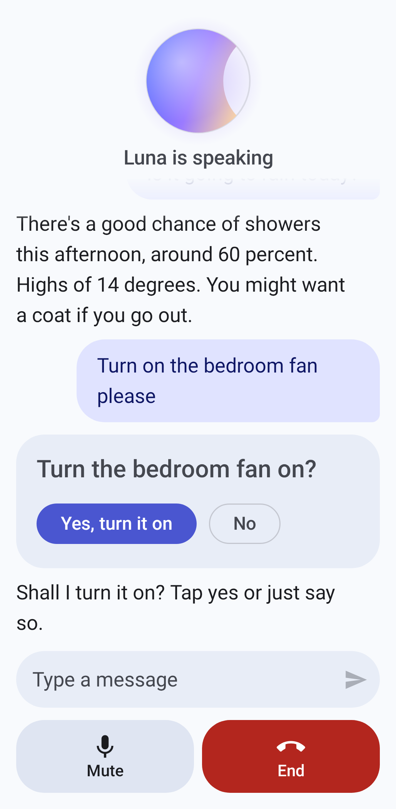
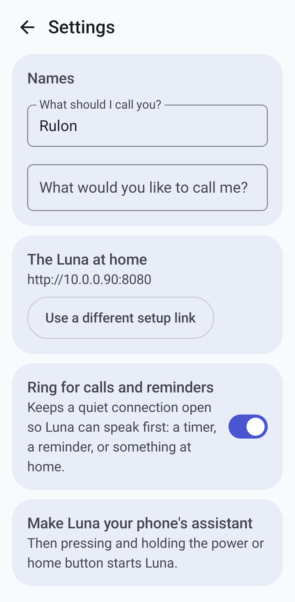
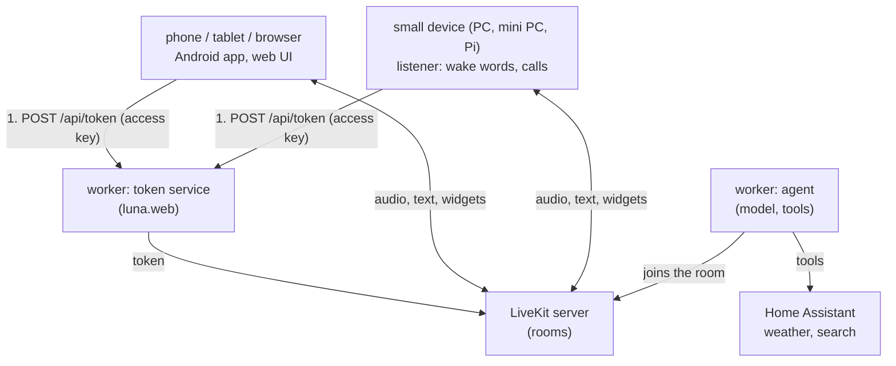

# Luna

<p align="center"></p>

Luna is a voice assistant for an older person living at home. You talk to it (on a phone, a tablet, a browser or a small always-on
device) and it answers questions, controls [Home Assistant](https://www.home-assistant.io) (lights, TV, fan; it can read temperatures and door status),
sets timers and reminders, shows widgets such as a weather card, and passes requests only a person can do to a caregiver. What it can do is limited to an allowlist inthe config, and there is a dry-run mode, but no per-action approval step (see [`SECURITY.md`](SECURITY.md)). The conversation runs over
[LiveKit](https://livekit.io); the language model and speech providers are configurable in `worker/config.yaml` (separate speech-to-text, model and
text-to-speech plugins, or a realtime model such as Gemini Live).

<table>
  <tr>
    <td align="center"></td>
    <td align="center"></td>
    <td align="center"></td>
  </tr>
  <tr>
    <td align="center"><b>1. Home</b><br>Press Talk, or say a wake word</td>
    <td align="center"><b>2. Conversation</b><br>Voice, text and widgets</td>
    <td align="center"><b>3. Settings</b><br>Names, server, calls and reminders</td>
  </tr>
</table>

## Quick start

You need [Docker](https://docs.docker.com/get-docker/) and [Python 3](https://www.python.org/downloads/) (only to make two random secrets;
`openssl rand -hex 32` and `openssl rand -base64 24` work too). Luna starts in **dry-run mode**: it reads Home Assistant but changes nothing.

```sh
cp .env.example .env              # Windows PowerShell: Copy-Item .env.example .env
python -c "import secrets; print(secrets.token_hex(32)); print(secrets.token_urlsafe(24))"   # two random values
```

In `.env`, put the first value in `LIVEKIT_API_SECRET`, put `laptop:<the second value>` in `LUNA_ACCESS_KEYS`, and add your provider API keys
(`DEEPGRAM_API_KEY`, `OPENAI_API_KEY` and `CARTESIA_API_KEY` by default). Then:

```sh
docker compose up --build
```

Open `http://localhost:8080/#key=<the second value>`, press **Talk to Luna** and allow the microphone.

> [!TIP]
> **Let an AI agent do the setup.** Ask Claude Code, Codex, Cursor or a similar agent:
>
> ```text
> From https://github.com/TrendMend/luna, install Luna using the Docker quick start in the README. Read AGENTS.md first.
> ```
>
> [`AGENTS.md`](AGENTS.md) tells it how to set up safely: it asks you for your API keys, keeps dry-run on, and checks that Luna is running.

Phones and tablets, Home Assistant, running without Docker, Kubernetes and NixOS: [`docs/deployment.md`](docs/deployment.md).
Tests and checks: [`docs/development.md`](docs/development.md).

## Architecture



| Folder | What it is |
|---|---|
| [`worker/`](worker/) | the LiveKit agent (speech, model, tools, A2UI widgets) and the token and reminder service |
| [`listener/`](listener/) | device endpoint: local wake words (openWakeWord), calls (a `luna.call` message from the LiveKit server API, for example sent by Home Assistant), LiveKit audio |
| [`web/`](web/) | browser UI that can be installed as a home-screen app |
| [`android/`](android/) | Android app: conversation, widgets (official A2UI renderer), calls and reminders, on-device wake words, MDM configuration ([`android/MDM.md`](android/MDM.md)) |
| [`deploy/`](deploy/), [`docker-compose.yml`](docker-compose.yml), [`flake.nix`](flake.nix), [`nix/`](nix/) | Kubernetes, Compose, Nix package and NixOS modules |
| [`docs/`](docs/) | [the protocol](docs/protocol.md) between the parts, [deployment](docs/deployment.md), [releasing](docs/releasing.md) |

## License

The project's code is Apache-2.0 ([`LICENSE`](LICENSE)). Third-party code and models keep their own licenses
([`THIRD_PARTY.md`](THIRD_PARTY.md)). In particular openWakeWord's pre-trained models are **non-commercial** (CC BY-NC-SA 4.0) and are
not stored here: `scripts/fetch_wakeword_models.py` downloads them for the Android app.
