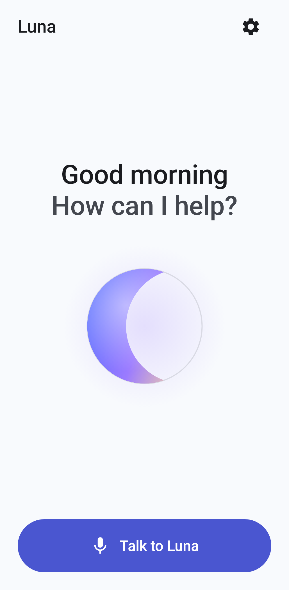

# Luna

<p align="center"></p>

Luna is a voice assistant for an older person living at home. You talk to it (on a phone, a tablet, a browser or a small always-on
device) and it answers questions, controls [Home Assistant](https://www.home-assistant.io) (lights, TV, fan; it can read temperatures and door status),
sets timers and reminders, shows widgets such as a weather card, and passes requests only a person can do to a caregiver. What it can do is limited to an allowlist inthe config, and there is a dry-run mode, but no per-action approval step (see [`SECURITY.md`](SECURITY.md)). The conversation runs over
[LiveKit](https://livekit.io); the language model and speech providers are configurable in `worker/config.yaml` (separate speech-to-text, model and
text-to-speech plugins, or a realtime model such as Gemini Live).

<p>
  
  
  
</p>

These are the Android app's screenshot-test renders (`android/app/src/screenshotTestDebug/reference/`), drawn from sample data, not
captures from a device.

## Architecture

```
  phone / tablet / browser            small device (PC, NUC, Pi)
  Android app, web UI                 listener: wake words, calls
          |                                   |
          |  1. POST /api/token (access key)  |
          v                                   v
   +--------------------+   token    +-----------------+
   | worker: token      | ---------> |  LiveKit server |  audio, text, widgets
   | service (luna.web) |            |   (rooms)       |  <------------------+
   +--------------------+            +-----------------+                     |
                                             ^                               |
                                             | agent joins the room          |
                                      +------------------+  tools   +----------------+
                                      | worker: agent    | -------> | Home Assistant |
                                      | (model, tools)   |          | weather, search|
                                      +------------------+          +----------------+
```

| Folder | What it is |
|---|---|
| [`worker/`](worker/) | the LiveKit agent (speech, model, tools, A2UI widgets) and the token and reminder service |
| [`listener/`](listener/) | device endpoint: local wake words (openWakeWord), calls (a `luna.call` message from the LiveKit server API, for example sent by Home Assistant), LiveKit audio |
| [`web/`](web/) | browser UI that can be installed as a home-screen app |
| [`android/`](android/) | Android app: conversation, widgets (official A2UI renderer), calls and reminders, on-device wake words, MDM configuration ([`android/MDM.md`](android/MDM.md)) |
| [`deploy/`](deploy/), [`docker-compose.yml`](docker-compose.yml), [`flake.nix`](flake.nix), [`nix/`](nix/) | Kubernetes, Compose, Nix package and NixOS modules |
| [`docs/`](docs/) | [the protocol](docs/protocol.md) between the parts, [deployment](docs/deployment.md), [releasing](docs/releasing.md) |

## Quick start

You need [uv](https://docs.astral.sh/uv/) and API keys for the providers named in `worker/config.yaml` (copy `.env.example` to `.env`).
Everything starts in dry-run mode (`LUNA_DRY_RUN=1`): Home Assistant is read, nothing is switched, nobody is notified.

```sh
cd worker
uv sync --extra openai --extra deepgram --extra cartesia   # the extras config.yaml uses (google for Gemini)
uv run python -m livekit.agents download-files
uv run python -m luna.agent console             # talk through this computer's microphone and speakers (no LiveKit server needed)
```

Run the tests (none of them needs a network, a device or a key):

```sh
cd worker   && uv run --extra openai --extra deepgram --extra cartesia --extra google --group dev pytest -q
cd listener && uv run --group dev pytest -q
node --test web/test
python scripts/fetch_wakeword_models.py          # once, for the Android tests (downloads non-commercial models, see below)
cd android  && ./gradlew :app:testDebugUnitTest :app:assembleDebug     # JDK 17 and the Android SDK
```

Running the full system (LiveKit server, token service, devices): [`docs/deployment.md`](docs/deployment.md).

## Verified status

Last checked by running the commands above on 2026-11-13: worker 142 tests, listener 21 (24 with `--extra wakeword`, which three tests need), web 6 and Android 76 unit tests pass; a fresh clone gave the same results.
Those tests use fakes for Home Assistant, weather, TV, LiveKit delivery and the model providers.

**In production:** The maintainer reports (2026-11-13) that the whole system has been confirmed working in production use. No test logs or per-feature records back that report; it is the owner's statement. The component READMEs and the changelog still record the narrower, earlier checks (a spoken console conversation
with a door-status tool call, wake-word detection on a live microphone, a call through a real LiveKit server, a headless-browser check
of the web renderer), and the unit tests above are the only evidence kept in the repository.

**Known gaps that are features, not verification:** there is no Home Assistant-side component for calls (a `luna.call` message is sent with the LiveKit server API, see the protocol); the web renderer lacks List templates,
function calls inside values, Video and AudioPlayer; the Android settings screen does not grey out each managed control. See
[`TODO.md`](TODO.md).

## License

The project's code is Apache-2.0 ([`LICENSE`](LICENSE)). Third-party code and models keep their own licenses
([`THIRD_PARTY.md`](THIRD_PARTY.md)). In particular openWakeWord's pre-trained models are **non-commercial** (CC BY-NC-SA 4.0) and are
not stored here: `scripts/fetch_wakeword_models.py` downloads them for the Android app.
